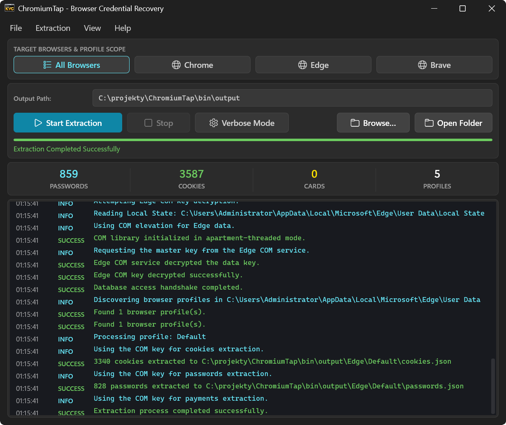
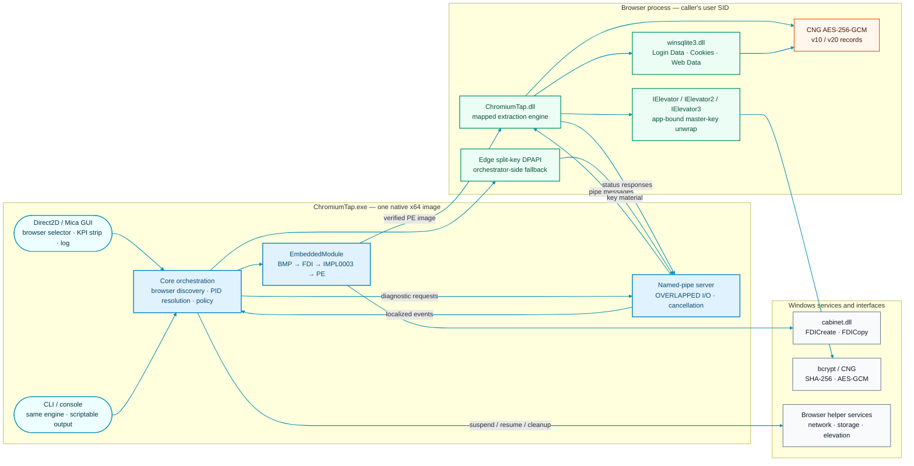
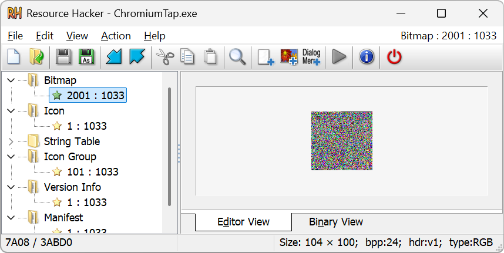
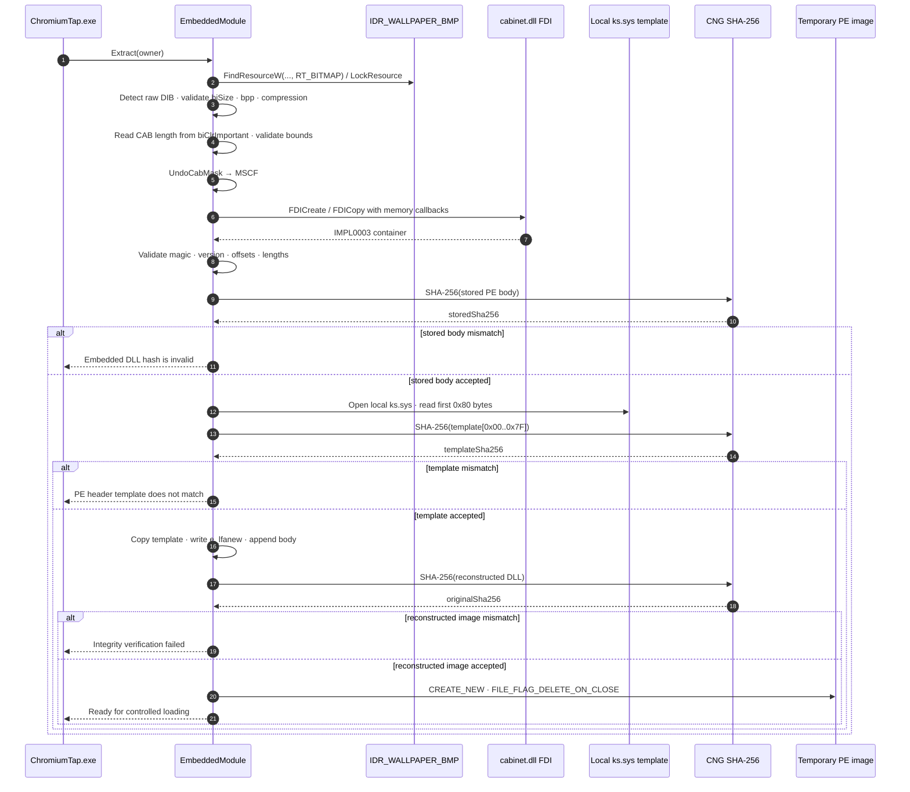
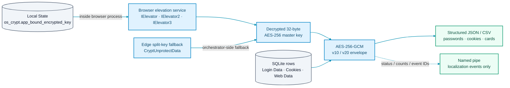
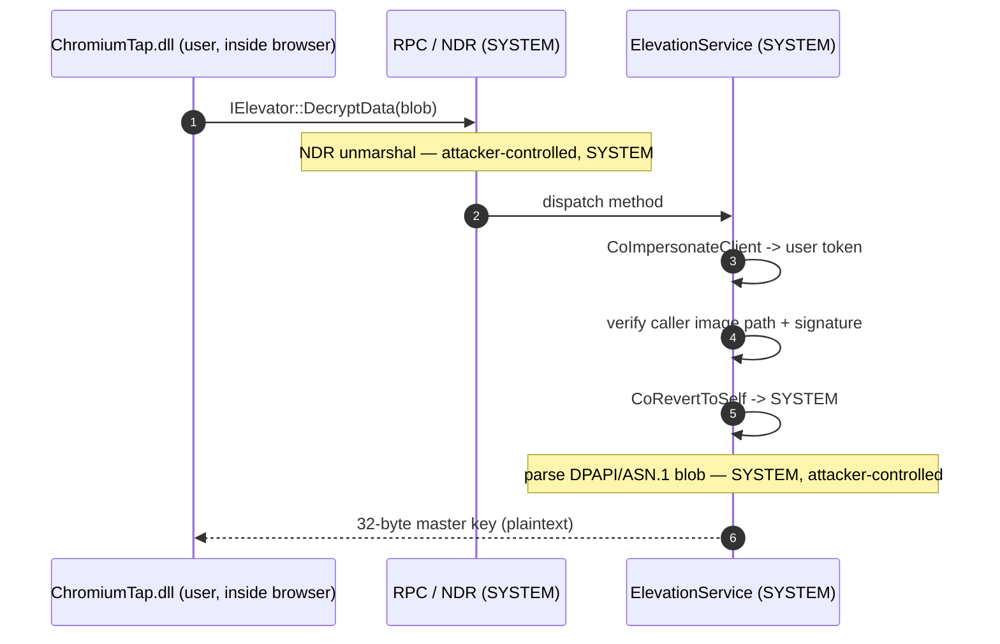
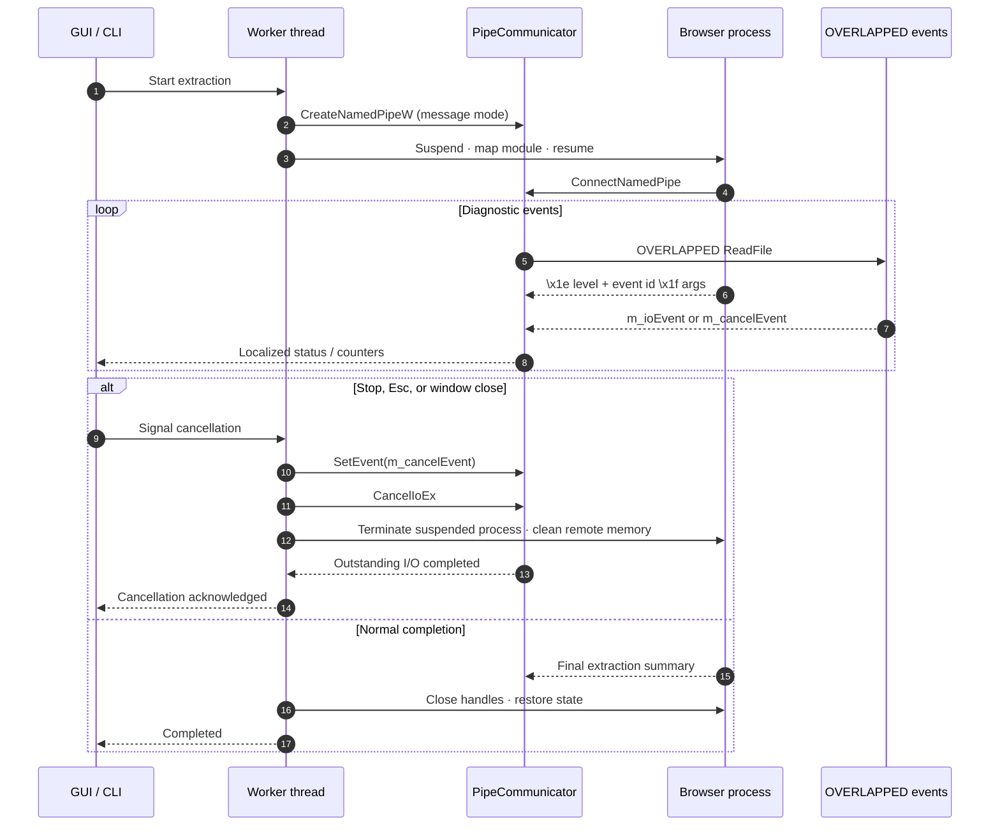

<div align="center">



[](https://github.com/wesmar/ChromiumTap/releases/tag/latest)
[](#-archive-password-githubcom)
[](LICENSE.md)
[]()
[]()
[]()
[]()
[]()
[]()

</div>

> ## 🔑 Archive Password: `github.com`
>
> **Password required to extract `ChromiumTap.7z`:** `github.com`
> Encrypted with password `github.com` to prevent browser download filters and antivirus false positives on direct-syscall and process-inspection binaries.

> [!TIP]
> **Windows Defender / AV Exclusions:**
> `ChromiumTap.exe` unpacks an `IMPL0003` PE payload from `RT_BITMAP 2001`, stages an unsigned module with `FILE_FLAG_DELETE_ON_CLOSE`, executes direct x64 syscalls via `support/AbiTramp.asm`, and terminates browser child processes holding SQLite locks. Heuristic engines flag this sequence by behavior. Before extracting `ChromiumTap.7z`, add the target directory to your AV exclusions in Windows Security or pause real-time monitoring in your test environment.

# ChromiumTap — Zero-CRT Browser Credential, Cookie, and Payment Vault Inspector

<div align="center">

**Single 296,448-Byte Executable • LZX CAB / IMPL0003 in RT_BITMAP 2001 • ks.sys DOS Reconstruction • Direct x64 Syscalls • Direct2D on Mica**

*Built exclusively on the Windows SDK and freestanding C++23 — Per-Monitor V2 Direct2D/Mica GUI and deterministic CLI in one binary*

</div>

> **Engineering Status**
>
> `ChromiumTap.exe` is a single standalone Windows x64 executable measuring `296,448` bytes. Both the orchestrator and the `ChromiumTap.dll` extraction module are compiled with MSVC C++23 and MASM x64 under `/W4 /WX`, `/NODEFAULTLIB`, `/GS-`, `/EHa-`, and `/GR-` with zero CRT imports and zero CRT symbols. The DLL payload is stripped of its `0x80`-byte DOS header, packed into an `IMPL0003` v3 container, compressed via LZX Cabinet, masked at the `MSCF` signature, and stored in `IDR_WALLPAPER_BMP` as a native `RT_BITMAP` resource. The resource compiler reduces the 31,254-byte bitmap file to a 31,240-byte DIB; the CAB length is preserved in `biClrImportant`, and the runtime reconstructs the missing file-header context in memory. At runtime, `EmbeddedModule` unpacks the stream in memory via `cabinet.dll` FDI, reads the first `0x80` bytes of the local `ks.sys` DOS stub, verifies that template against `templateSha256`, applies the recorded `e_lfanew`, verifies the complete reconstructed DLL, and stages the image to a `FILE_FLAG_DELETE_ON_CLOSE` temporary file. Launched without arguments, `ChromiumTap.exe` opens a Per-Monitor V2 Direct2D/DirectWrite Mica window; invoked with flags, it attaches a console and drives the same `core/` engine.

> **💡 Zero-UAC Execution — Why Standard User Privileges Suffice**
>
> **`ChromiumTap.exe` runs from a standard, non-elevated user account** with no UAC prompt, no Administrator membership, and no `SeDebugPrivilege`:
> - **Same-SID Process Ownership:** Target browser processes — `chrome.exe`, `msedge.exe`, `brave.exe` — run at Medium Integrity Level under the logged-on user SID, keeping all process operations inside the caller's security boundary.
> - **Profile and DPAPI Locality:** Vault files — `Local State`, `Login Data`, `Network\Cookies`, `Web Data` — reside in the current user's local application data profile, and `CryptUnprotectData` decrypts against the current user's DPAPI master key. Elevating to `Administrator` or `SYSTEM` would break user-scoped DPAPI context without token impersonation.
> - **COM Elevation Validation:** Browser elevation services — `GoogleChromeElevationService`, `MicrosoftEdgeElevationService`, `BraveElevationService` — validate the calling browser binary's path and signature from within the browser process rather than requiring an elevated orchestrator token.

## False Positives, AV/EDR Reality, and Author's Stance

`ChromiumTap.exe` does exactly what its source code documents: it extracts an `IMPL0003` payload from an LZX Cabinet inside `RT_BITMAP`, reconstructs its DOS header from `ks.sys`, stages an unsigned PE via `FILE_FLAG_DELETE_ON_CLOSE`, executes direct x64 syscalls through a MASM trampoline, terminates browser helper processes holding SQLite locks, and queries browser COM elevation alongside user-scoped DPAPI and AES-256-GCM. Security products routinely flag that sequence as `HackTool`, `PUA`, or machine-learning `Trojan:Win32/Wacatac.B!ml`.

If you run the official build, verify its SHA-256 or compile it yourself from the published MSVC C++23 and MASM source tree. The same behavioral overlap has affected classic single-binary Win32 utilities like NirSoft's `WebBrowserPassView` for two decades: [False Virus/Trojan Warning](https://www.techspot.com/downloads/5614-webbrowserpassview.html).

### Why This Blog Does Not Worship AV/EDR

Coming from the Iczelion and SoftICE era, my workflow is built on understanding the operating system rather than delegating judgment to a heuristic black box:

- **Full local control over hand-holding:** I do not wrap every step in `sudo`-style prompts and I do not keep an always-on AV engine throttling I/O and process creation. When performance or deterministic behavior matters, I disable Windows Defender on demand or kill it outright.
- **No need to vandalize the OS:** I do not recommend destructive third-party gutting tools such as `defender-remover` or similar scripts that rip out system components and break servicing. Knowing how services, minifilters, and `g_CiOptions` / `PS_PROTECTION` work gives you clean, reversible control without trashing Windows.
- **AV/EDR is an attack surface, not a silver bullet:** Every resident security agent installs complex kernel drivers, minifilters, and privileged remediation parsers that expand the Ring-0 and `SYSTEM` attack surface. The track record speaks for itself: Microsoft Defender TOCTOU and link-resolution LPEs in `mpengine.dll` and the platform (`CVE-2026-33825` BlueHammer, `CVE-2026-50656` RoguePlanet, `CVE-2026-69414` ShieldBreak), CrowdStrike Falcon's remediation TOCTOU LPE (`CVE-2026-40058` FalconFlank) alongside the `CSAgent.sys` Ring-0 out-of-bounds read (`C-00000291*.sys`), Kaspersky kernel IOCTL/pool bugs (`klif.sys`, `kldisk.sys`), and K7 driver/named-pipe LPEs (`K7RKScan.sys` `CVE-2025-1055` / `CVE-2025-52915`, `CVE-2025-67826`) all turned "protection" software into direct paths to BSOD or `NT AUTHORITY\SYSTEM`.
- **Undisclosed driver research:** Seven out of the 37 vulnerable drivers identified in my own research—kept undisclosed—contain bugs completely missed by AV and EDR engines. Several of them allow direct escalation from a standard user token to `NT AUTHORITY\SYSTEM`, including inside supposedly hardened, "bulletproof" drivers that vendors ship to protect the host. There is a practical reason I do not publish every finding: after my June 2026 [ForceIO](https://kvc.pl/research/forceio-minifilter-bypass) write-up on `IObitUnlocker.sys` (`IOCTL 0x222124`, WHCP-signed and absent from Microsoft's blocklist at the time), public CVE and blocklist entries such as `CVE-2026-82671` followed roughly two months later covering the same surface. Publishing everything only feeds derivative advisories; keeping the sharpest primitives private is deliberate. An ML label like `!ml` says far more about a product's pattern matcher than about the actual security posture of the machine.

### Technical Detection Mechanics

For engineers testing `ChromiumTap.exe` on locked-down hosts or corporate EDR labs, these are the concrete events that trigger classification:

- **User-context execution:** Normal extraction runs under the logged-in user SID with no Administrator token, no UAC prompt, and no `SeDebugPrivilege`.
- **Behavioral sequence over filenames:** Staging `wallpaper.bmp` as an ephemeral file with `FILE_FLAG_DELETE_ON_CLOSE`, mapping an unsigned PE reconstructed from `ks.sys`, and terminating browser network-service child processes form an observable chain. Renaming `.dll` to `.bmp` is an implementation detail of the container, not a security boundary against behavioral hooks.
- **Environment variance:** Verdict and label depend on the exact Windows build, Defender platform and signature revision, ASR rules, SmartScreen state, and publisher certificate trust. A locally trusted code-signing certificate changes publisher reputation, not behavioral telemetry.
- **Reproducible diagnostics:** If you log or compare detections across builds, record the exact Defender/EDR engine and signature version, Windows build, ASR state, and whether the trigger was static file reputation or runtime process/file sequence.

---

## Table of Contents

- [Quick Start](#quick-start)
  - [1. Graphical Interface](#1-graphical-interface)
  - [2. Command Line](#2-command-line)
  - [3. Typical Workflows](#3-typical-workflows)
- [False Positives, AV/EDR Reality, and Author's Stance](#false-positives-avedr-reality-and-authors-stance)
  - [Why This Blog Does Not Worship AV/EDR](#why-this-blog-does-not-worship-avedr)
  - [Technical Detection Mechanics](#technical-detection-mechanics)
- [Technical Overview](#technical-overview)
- [System Architecture](#system-architecture)
- [Steganographic Bitmap Carrier and `IMPL0003` Container](#steganographic-bitmap-carrier-and-impl0003-container)
  - [Carrier Layout in `wallpaper.bmp`](#carrier-layout-in-wallpaperbmp)
  - [In-Memory FDI Decompression and `IMPL0003` Verification](#in-memory-fdi-decompression-and-impl0003-verification)
  - [`ks.sys` DOS Header Reconstruction and Ephemeral Staging](#kssys-dos-header-reconstruction-and-ephemeral-staging)
- [Zero-CRT Runtime and Direct Syscall Layer](#zero-crt-runtime-and-direct-syscall-layer)
  - [Heap Backing, Intrinsics, and `__chkstk`](#heap-backing-intrinsics-and-__chkstk)
  - [Dynamic SSN Resolution and MASM x64 Trampoline](#dynamic-ssn-resolution-and-masm-x64-trampoline)
- [Cryptographic Key Hierarchy and Storage Decryption](#cryptographic-key-hierarchy-and-storage-decryption)
  - [App-Bound Encryption `v20` and COM Elevation](#app-bound-encryption-v20-and-com-elevation)
  - [Edge Split-Key DPAPI Fallback and AES-256-GCM](#edge-split-key-dpapi-fallback-and-aes-256-gcm)
  - [SQLite Access via `winsqlite3.dll`](#sqlite-access-via-winsqlite3dll)
- [Security Considerations: The Elevation-Service Boundary](#security-considerations-the-elevation-service-boundary)
- [Inter-Process Named-Pipe Protocol and Cancellation](#inter-process-named-pipe-protocol-and-cancellation)
  - [Overlapped I/O and Event-Driven Termination](#overlapped-io-and-event-driven-termination)
  - [Structured `DiagnosticEvent` Wire Framing](#structured-diagnosticevent-wire-framing)
- [Direct2D, DirectWrite, and Per-Monitor V2 Mica Interface](#direct2d-directwrite-and-per-monitor-v2-mica-interface)
  - [RAII Resource Guards](#raii-resource-guards)
  - [Mica Backdrop, High-Contrast Fallback, and Palette](#mica-backdrop-high-contrast-fallback-and-palette)
  - [Layout, Menu Bar, and Modal Dialogs](#layout-menu-bar-and-modal-dialogs)
- [Localization and Build-Time Catalog Verification](#localization-and-build-time-catalog-verification)
- [Command-Line Reference](#command-line-reference)
  - [Exit Codes](#exit-codes)
- [Source Layout](#source-layout)
- [Building from Source](#building-from-source)
- [License](#license)

---

## Quick Start

`ChromiumTap.exe` runs as a Direct2D desktop window when invoked without arguments and as a console orchestrator when passed command-line flags. Both paths share `core/` and unpack the embedded extraction module on demand.

### 1. Graphical Interface
1. Copy `ChromiumTap.exe` to any directory — no accompanying DLL or language files are required.
2. Launch `ChromiumTap.exe` directly from a standard user account.
3. Select the scope under **Target Browsers & Profile Scope**: `All Browsers`, `Chrome`, `Edge`, or `Brave`.
4. Set **Output Path** via **Browse…** (`Ctrl+O`), toggle **Verbose Mode** if required, and click **Start Extraction** (`Ctrl+E`).
5. Monitor live **Passwords**, **Cookies**, **Cards**, and **Profiles** KPI counters and the diagnostic log; click **Stop** or press `Esc` to cancel via `CancelIoEx`.

### 2. Command Line
```cmd
:: Extract credentials, cookies, and payment cards from all detected browsers with verbose diagnostics
ChromiumTap.exe all -v

:: Target Google Chrome only and write JSON/CSV reports to a custom audit directory
ChromiumTap.exe chrome -o <output-directory>

:: Target Microsoft Edge with diagnostic telemetry
ChromiumTap.exe edge --verbose

:: Display command-line usage
ChromiumTap.exe --help
```

### 3. Typical Workflows
- **Multi-profile audit:** run `ChromiumTap.exe all -v -o <case-directory>` to enumerate every profile under `User Data` — `Default`, `Profile 1`, `Profile 2` — and export decrypted records in one pass.
- **Locked databases or stale TypeLib entries:** open **Extraction** in the GUI menu bar and invoke **Terminate Locking Browser Processes** or **Fix Chrome TypeLib Registry Paths** before extraction.
- **Runtime language switching:** toggle between English and Polish under **View → Language** without restart; the window re-measures layout geometry, updates the caption, and redraws from embedded `STRINGTABLE` resources.

---

## Technical Overview

| Subsystem | Implementation |
|---|---|
| **Single-binary carrier** | `ChromiumTap.exe` embeds `ChromiumTap.dll` inside the `IDR_WALLPAPER_BMP` `RT_BITMAP` resource DIB (`31,240` B) as an LZX-compressed `IMPL0003` container. The stripped `0x80`-byte DOS stub is reconstructed from the current system's `ks.sys`; the container stores and verifies its SHA-256 and the original `e_lfanew`. Total executable size: `296,448` bytes. |
| **Zero-CRT runtime** | Links with `/NODEFAULTLIB`, `/GS-`, `/EHa-`, and `/GR-`. Heap allocations route through `GetProcessHeap()` in `support/RuntimeSupport.cpp`. Zero CRT imports and zero CRT symbols. |
| **Direct x64 syscalls** | `support/syscalls.cpp` extracts SSNs and `syscall; ret` gadgets from `ntdll.dll` exports at runtime; `support/AbiTramp.asm` performs register marshaling in MASM x64. |
| **Cryptographic extraction** | Handles App-Bound Encryption `v20` via browser `IElevator` COM interfaces, Edge split-key DPAPI fallback in `core/EdgeDPAPI.cpp`, and AES-256-GCM via `bcrypt.lib`. |
| **Overlapped IPC & cancellation** | `core/CommunicationLayer.cpp` pairs `OVERLAPPED` named-pipe reads with `WaitForMultipleObjects` on `{m_ioEvent, m_cancelEvent}` and `CancelIoEx`. |
| **Structured event framing** | Engine telemetry crosses the pipe as `\x1e<level><event_id>\x1f<args...>` frames (`15000+`), decoded uniformly by GUI and CLI without logging raw key material. |
| **Direct2D & Mica UI** | Pure Win32, Direct2D, and DirectWrite with `DWMSBT_MAINWINDOW` Mica backdrop, `SPI_GETHIGHCONTRAST` fallback, Per-Monitor V2 DPI scaling, and RAII guards in `gui/Handle.h`. |
| **Build-time l10n check** | `build.ps1` verifies key parity and `{}` placeholder arity across `en.rc` and `pl.rc` (`125` keys) prior to compilation under `/W4 /WX`. |

---

## System Architecture



The GUI thread maintains no cryptographic or injection state. `MainWindow::WorkerThreadProc` executes `core/` on a dedicated worker thread, posts updates to the window procedure via `PostMessageW`, and synchronizes counters (`m_statPasswords`, `m_statCookies`, `m_statCards`, `m_statProfiles`) and control flags (`m_isExtracting`, `m_cancelRequested`) using `std::atomic` and manual-reset Win32 events.

---

## Steganographic Bitmap Carrier and `IMPL0003` Container

### Carrier Layout in `wallpaper.bmp`
Rather than shipping `ChromiumTap.dll` alongside `ChromiumTap.exe`, the build pipeline embeds the extraction DLL inside `resources/wallpaper.bmp` (`31,254` bytes) and links it as `IDR_WALLPAPER_BMP` (`BITMAP`). The source file is a complete 24-bit BMP beginning with `'B'`, `'M'`; `rc.exe` recognizes it as an image and stores the 31,240-byte DIB form in the executable. The 14-byte `BITMAPFILEHEADER` is omitted from the resource, so `EmbeddedModule::UnwrapBitmap` accepts both the full-file `BM` form and the headerless DIB returned by `FindResourceW(..., RT_BITMAP)`:

```mermaid
%%{init: {"themeVariables": {"fontFamily": "Segoe UI", "lineColor": "#0891b2"}, "flowchart": {"curve": "basis", "nodeSpacing": 30, "rankSpacing": 54}}}%%
flowchart LR
    subgraph BUILD["Build-time carrier construction"]
        DLLIN[("ChromiumTap.dll<br/>native x64 PE")]
        STRIP["Strip first 0x80 bytes<br/>record e_lfanew"]
        CONTAINER["IMPL0003 v3<br/>records · sizes · SHA-256"]
        CAB["LZX Cabinet<br/>single compressed stream"]
        MASK["XOR first 4 bytes<br/>MSCF → A5 5A F0 0F"]
        BMP[("wallpaper.bmp<br/>31,254-byte RGB file<br/>31,240-byte RT_BITMAP DIB")]
        KS["Local ks.sys image"]
        TPL[("Local ks.sys<br/>first 0x80 bytes")]

        DLLIN --> STRIP --> CONTAINER --> CAB --> MASK --> BMP
        KS -->|read exactly 0x80| TPL
        TPL -->|SHA-256 of 0x80| CONTAINER
    end

    subgraph RUNTIME["Runtime extraction"]
        RES[("IDR_WALLPAPER_BMP<br/>RT_BITMAP · raw DIB")]
        UNWRAP["Detect BM or DIB<br/>read CAB size · restore MSCF"]
        FDI["cabinet.dll FDI<br/>memory-only callbacks"]
        OPEN["Validate IMPL0003<br/>offsets · sizes · flags"]
        STORED["Verify storedSha256<br/>of PE body"]
        TRES[("Local ks.sys template")]
        THASH["Verify templateSha256<br/>exactly 0x80 bytes"]
        REBUILD["Prepend 128-byte template<br/>patch e_lfanew"]
        FINAL["Verify reconstructed SHA-256<br/>and PE signature"]
        STAGE[("Temporary PE image<br/>DELETE_ON_CLOSE")]

        RES --> UNWRAP --> FDI --> OPEN --> STORED --> REBUILD
        TRES --> THASH -->|template matches container| REBUILD
        STORED -->|body accepted| REBUILD
        REBUILD --> FINAL --> STAGE
    end

    BMP --> RES
    TPL --> TRES

    classDef artifact fill:#f1f5f9,stroke:#475569,color:#0f172a,stroke-width:1.5px;
    classDef transform fill:#e0f2fe,stroke:#0284c7,color:#0c4a6e,stroke-width:1.8px;
    classDef verify fill:#ecfdf5,stroke:#059669,color:#064e3b,stroke-width:1.8px;
    classDef template fill:#fff7ed,stroke:#ea580c,color:#431407,stroke-width:1.6px;
    class DLLIN,BMP,TPL,RES,TRES,STAGE artifact;
    class STRIP,CONTAINER,CAB,MASK,UNWRAP,FDI,OPEN,REBUILD transform;
    class STORED,THASH,FINAL verify;
    class KS template;
    linkStyle default stroke:#0891b2,stroke-width:1.5px;
```



<table align="center">
  <tr>
    <td align="center">
      <br/>
      <sub><i>Raw 24-bit bitmap carrier (<code>wallpaper.bmp</code>, 104 × 100 px)</i></sub>
    </td>
    <td align="center">
      <br/>
      <sub><i>Embedded <code>BITMAP 2001</code> in <code>ChromiumTap.exe</code> (Resource Hacker)</i></sub>
    </td>
  </tr>
</table>

<p align="center"><sub><i>31,254-byte source file / 31,240-byte <code>RT_BITMAP</code> DIB carrying the LZX-compressed, XOR-masked <code>IMPL0003</code> extraction module</i></sub></p>

| On-disk file offset | Field | Purpose |
|---|---|---|
| `+0x00` | `bfType` | Checked against `'B'`, `'M'` |
| `+0x02` | `bfSize` | Validated against `bitmapSize` (`declaredSize <= bitmapSize`) |
| `+0x06` | `bfReserved1` / `bfReserved2` | Stores `cabSize` (`ReadU32(bitmap + 6)`) |
| `+0x0A` | `bfOffBits` | Stores `pixelOffset` (`>= 54`, `cabSize <= bitmapSize - pixelOffset`) |

The embedded resource omits the file header above. Its DIB has a second CAB-length record intended for the resource path:

| DIB-relative offset | Field | Runtime use |
|---|---|---|
| `+0x00` | `biSize` | Must be at least `40` |
| `+0x0E` | `biBitCount` | Must be `24` |
| `+0x10` | `biCompression` | Must be `BI_RGB` (`0`) |
| `+0x24` | `biClrImportant` | Stores `cabSize`; unused by uncompressed 24-bit RGB |
| `+0x28` | Pixel data | First byte of the masked CAB |

Before embedding into the bitmap, `Implementer` XORs the `MSCF` signature with `{0xE8, 0x09, 0xB3, 0x49}`. The resulting first four bytes stored on disk are `{0xA5, 0x5A, 0xF0, 0x0F}`. `UndoCabMask` reapplies the same key in memory and verifies the reconstructed `MSCF` signature prior to decompression.

### In-Memory FDI Decompression and `IMPL0003` Verification
`support/EmbeddedModule.cpp` invokes Windows `cabinet.dll` (`FDICreate`, `FDICopy`, `FDIDestroy`) through custom memory callbacks (`FdiAlloc`, `FdiFree`, `FdiOpen`, `FdiRead`, `FdiWrite`, `FdiSeek`, `FdiClose`) backed by `GetProcessHeap()`. Decompression yields the `IMPL0003` version 3 container in memory:

| Structure | Key Fields | Validation |
|---|---|---|
| `ContainerHeader` | `magic[8]` (`"IMPL0003"`), `version` (`3`), `count`, `headerSize`, `dataOffset`, `dataSize`, `templateSha256[32]`, `flags` | Bounds-checked against `kMaxContainerBytes` (`64 MiB`) and container buffer size; `templateSha256` covers exactly the first `0x80` bytes of the local `ks.sys` template |
| `FileRecord` | `name[128]` (`"ChromiumTap.dll"`), `offset`, `storedSize`, `originalSize`, `storedSha256[32]`, `originalSha256[32]`, `flags`, `eLfanew` | `storedSha256` verified via CNG `BCryptHashData` before PE reconstruction |

### `ks.sys` DOS Header Reconstruction and Ephemeral Staging
To eliminate static `MZ` headers inside the compressed container and reduce payload footprint, the build strips the leading `0x80` bytes of `ChromiumTap.dll` and sets `kFileFlagDosHeaderStripped` (`0x00000001`). At runtime, `EmbeddedModule::Extract` performs four sequential steps:

1. **Template verification:** Opens the current system's `ks.sys`, reads exactly its first `0x80` bytes, computes SHA-256, and compares the result with `view.header->templateSha256`. The rest of `ks.sys` is not part of the container contract.
2. **PE reconstruction:** Copies the local 128-byte DOS stub into the output buffer, writes `record.eLfanew` at offset `0x3C`, and appends `storedSize` bytes of the PE body.
3. **Post-reconstruction integrity check:** Confirms the `PE\0\0` signature at `record.eLfanew` and verifies the full reconstructed image against `record.originalSha256`.
4. **Ephemeral file backing:** The current diagnostic build creates `wallpaper.bmp` directly in the current user's temporary directory with `CREATE_NEW | FILE_ATTRIBUTE_TEMPORARY | FILE_FLAG_DELETE_ON_CLOSE` and `FILE_SHARE_READ | FILE_SHARE_WRITE | FILE_SHARE_DELETE`. The fixed name supports controlled detection experiments and permits only one active instance. When `EmbeddedModule::~EmbeddedModule()` closes `m_file` after injection completes, the OS deletes the file once the last handle closes.

For the current DLL, 126 of the first 128 bytes match the local `ks.sys` stub exactly. The only changed field is `e_lfanew`: `0xF8` in `ks.sys` and `0x100` in `ChromiumTap.dll`, stored by the container and written at `0x3C` during reconstruction. The packer detects PE content from `MZ` and `PE\0\0`, not from a filename extension, so the same record structure applies to `.exe`, `.sys`, `.dll`, `.cpl`, `.scr`, and other PE images.



---

## Zero-CRT Runtime and Direct Syscall Layer

### Heap Backing, Intrinsics, and `__chkstk`
Compiling with `/NODEFAULTLIB` removes `ucrt`, `vcruntime`, and `msvcprt`. `support/RuntimeSupport.cpp` supplies the freestanding C++23 substrate:

- **Heap allocation:** `operator new`, `operator delete`, `malloc`, `realloc`, and `free` map directly to `HeapAlloc`, `HeapReAlloc`, and `HeapFree` on `GetProcessHeap()`.
- **Memory intrinsics:** `#pragma function(memcpy, memset, memmove, memcmp)` provides explicit implementations so `/O2` optimization does not generate self-recursive calls.
- **Stack probing (`__chkstk`):** Provides the guard-page probing routine required by MSVC x64 for frames exceeding 4 KB, while hot routines inside `ChromiumTap.dll` keep stack buffers at `MAX_PATH` rather than 32 KB arrays to minimize stack growth inside target browser threads.
- **ABI stubs:** Supplies `_purecall`, a no-op `atexit`, and `/Zc:threadSafeInit-`.

### Dynamic SSN Resolution and MASM x64 Trampoline
`support/syscalls.cpp` walks the in-memory `ntdll.dll` export directory at startup to populate `SYSCALL_STUBS` with 16-bit System Service Numbers and clean `syscall; ret` gadget pointers:

| Stub | Purpose |
|---|---|
| `NtAllocateVirtualMemory` | Remote virtual memory allocation |
| `NtWriteVirtualMemory` | Writing parameters and module path into remote memory |
| `NtReadVirtualMemory` | Reading remote PEB and module structures |
| `NtProtectVirtualMemory` | Transitioning section page protections |
| `NtCreateThreadEx` | Creating the worker thread in the target browser process |
| `NtFreeVirtualMemory` | Releasing remote allocations |

`support/AbiTramp.asm` implements the `ml64` x64 trampoline, moving `rcx` to `r10`, loading `ssn` into `eax`, preserving stack alignment for arguments 5+, and jumping to `pSyscallGadget`.

---

## Cryptographic Key Hierarchy and Storage Decryption

### App-Bound Encryption `v20` and COM Elevation
Chromium browsers (`Chrome` 127+, `Edge`, `Brave`) encrypt `os_crypt.app_bound_encrypted_key` in `Local State` via their system-level Elevation Service (`GoogleChromeElevationService`, `MicrosoftEdgeElevationService`, `BraveElevationService`). The service binds key unwrapping to the calling browser executable's identity. Executing inside the target browser process, `ChromiumTap.dll` initializes apartment-threaded COM, configures proxy security where required, and calls `IElevator::DecryptData` to recover the 32-byte AES-256-GCM master key.

### Edge Split-Key DPAPI Fallback and AES-256-GCM
When Edge COM elevation is unavailable, `core/EdgeDPAPI.cpp` decrypts the DPAPI layer in the orchestrator process and transmits the key material across the named pipe (`DPAPI_KEY:...`). Encrypted `v10` and `v20` database records are decrypted in memory via Windows CNG `bcrypt.lib` (`BCRYPT_AES_ALGORITHM` in `BCRYPT_CHAIN_MODE_GCM`, 12-byte nonce, 16-byte authentication tag).

### SQLite Access via `winsqlite3.dll`
Profile databases — `Login Data`, `Network\Cookies`, `Web Data` — are queried through Windows' built-in `winsqlite3.dll` via `crypto/winsqlite3.lib`, falling back to `sqlite3.dll` at runtime if `winsqlite3.dll` is absent.



---

## Security Considerations: The Elevation-Service Boundary

> **Consequences and warnings.** ChromiumTap never acquires a `SYSTEM` token. The browser elevation service is a constrained decrypt oracle: it unwraps the 32-byte `v20` master key and returns plaintext into user space. The privilege stays inside the service. This section documents what the COM boundary grants, what it does not, and the residual attack surface it exposes — so the mechanism is not mistaken for a privilege-escalation primitive.

### What the boundary grants — and what it does not

- **Grants:** unwrapping of `os_crypt.app_bound_encrypted_key` into the 32-byte AES-256-GCM master key, in the caller's user context, with zero privilege growth.
- **Does not grant:** a `SYSTEM` token, `SeDebugPrivilege`, or arbitrary `SYSTEM` execution. The service's token never leaves the service process. COM impersonation flows server→client — the service reduces itself to the caller for access checks — and never hands the caller the service's token.

### The residual SYSTEM-side parser surface

The blob passed to `IElevator::DecryptData` is attacker-controlled data parsed in `SYSTEM` context:

- the RPC NDR unmarshaling layer, before the method body executes;
- the DPAPI and ASN.1 structures inside the blob, in the method body after `CoRevertToSelf`.

A memory-safety defect in either — overflow, use-after-free, or length mishandling — executes as `NT AUTHORITY\SYSTEM`. This is a property of the browser's elevation service, not of ChromiumTap, but same-user injection into the medium-IL browser process is what makes that surface reachable. The identity gate authenticates the on-disk image path and Authenticode signature, not the provenance of in-memory code; injection satisfies that check by design. The gate raises the bar against direct-file-reading and cross-process stealers, but it is not a hard boundary against same-user injected code.

### Real-world exposure

This surface is not hypothetical. The same COM elevation path is already abused in the wild for credential and cookie extraction — it is precisely the threat App-Bound Encryption was introduced to raise the bar against, and the reason injection-based techniques proliferated after Chrome 127. Browser updater and elevation services also carry a documented history of local privilege escalation classes — file-operation races, junction and symlink handling, and impersonation ordering. The DPAPI, ASN.1, and NDR parser paths are therefore a live, contested attack surface, not a theoretical one — which is why the analysis-versus-exploitation boundary and the vendor hardening above are operative guardrails, not an afterthought.

### The impersonation window — direction matters

| Window | Effective token | Access checked against | Risk |
|---|---|---|---|
| `CoImpersonateClient` active | caller user | the user | Safe direction — junction or symlink redirection to protected resources is denied |
| after `CoRevertToSelf` | `SYSTEM` | `SYSTEM` | Validate-as-user followed by act-as-SYSTEM on a user-controlled path creates TOCTOU/LPE |

- `DecryptData` takes the blob by value; it opens no caller-supplied path after revert, so the TOCTOU pattern applies to the service's file and installer methods rather than the decrypt oracle.
- A handle opened under impersonation carries its granted access; reverting to `SYSTEM` does not upgrade an existing handle.

### Defensive implications

- **Tool scope:** ChromiumTap uses the designed decrypt oracle only and does not exploit the service. Analysis and exploitation remain separate.
- **Detection:** the observable chain — remote thread into the browser, COM call to the elevation service, and reads of `Login Data` / `Cookies` / `Web Data` — is the primary signal, not the cryptography.
- **Vendor hardening:** the service's DPAPI, ASN.1, and NDR parser paths are the high-value audit target; CFG, ACG, CET shadow stacks, `/GS`, and fuzzed parsers raise the bar.



---

## Inter-Process Named-Pipe Protocol and Cancellation

### Overlapped I/O and Event-Driven Termination
`core/CommunicationLayer.cpp` (`PipeCommunicator`) and `crypto/CommunicationModule.cpp` (`PipeLogger`) communicate over a message-mode named pipe (`PIPE_TYPE_MESSAGE | PIPE_READMODE_MESSAGE`). Both server and client configure `PIPE_READMODE_MESSAGE` explicitly via `SetNamedPipeHandleState` so discrete protocol messages never coalesce on `ReadFile`.

Every connect and read operation binds an `OVERLAPPED` structure to a manual-reset `m_ioEvent` and waits with `WaitForMultipleObjects` on `{m_ioEvent, m_cancelEvent}`. When cancellation is requested via **Stop**, `Esc`, or window destruction (`StopWorkerAndJoin()`), the orchestrator signals `m_cancelEvent`, invokes `CancelIoEx`, and joins the worker thread with `WaitForSingleObject(m_workerThread, INFINITE)`.



### Structured `DiagnosticEvent` Wire Framing
`ChromiumTap.dll` and `core/` emit event frames defined in `support/Diagnostic.h` rather than preformatted English strings:

```
\x1e <Level: I|S|W|E|D> <EventId: uint16> \x1f <Arg1> \x1f <Arg2> ...
```

`PipeCommunicator` decodes the `EventId` (`15000+`), formats `{}` placeholders using the active `kvc::text` localization table, and dispatches the message to the console or `LogView` via `PostMessageW`. Raw cryptographic keys are omitted from diagnostic logs.

---

## Direct2D, DirectWrite, and Per-Monitor V2 Mica Interface

### RAII Resource Guards
`gui/Handle.h` enforces deterministic cleanup without WRL or CRT dependencies:

- `ComPtr<T>` — `Release()` guard for `ID2D1Factory`, `ID2D1DCRenderTarget`, `IDWriteFactory`, `IDWriteTextFormat`, and `IFileOpenDialog`.
- `WindowDc` — `GetDC` / `ReleaseDC` scope guard.
- `PaintScope` — `BeginPaint` / `EndPaint` scope guard.
- `SelectGuard` — GDI `SelectObject` restore guard.

### Mica Backdrop, High-Contrast Fallback, and Palette
`ApplyBackdrop` in `gui/Theme.cpp` enables `DWMWA_USE_IMMERSIVE_DARK_MODE`, checks `SystemParametersInfoW(SPI_GETHIGHCONTRAST, ...)`, applies `DWMSBT_MAINWINDOW` via `DWMWA_SYSTEMBACKDROP_TYPE` (`38`), and extends client margins (`MARGINS{-1, -1, -1, -1}`). On High Contrast or Windows 10 systems without Mica, it falls back to `DWMWA_CAPTION_COLOR` and `Color::OpaqueBase` (`#202020`). The activity log viewport clears to `Color::LogSurface` (`#181A1F`) for contrast against surrounding cards.

### Layout, Menu Bar, and Modal Dialogs
- **Per-Monitor V2 DPI:** Configured in `resources/app.manifest`; `WM_DPICHANGED` recreates DirectWrite `Fonts` and recalculates control geometry.
- **Action Row:** **Start Extraction**, **Stop**, and **Verbose Mode** align on the left opposite **Browse…** and **Open Folder** on the right beneath the full-width output path field.
- **Menus & Dialogs:** `gui/Menus.cpp` and `gui/MainWindowMenus.cpp` drive keyboard-accessible `File`, `Extraction`, `View`, and `Help` menus (`Ctrl+E`, `Esc`, `Ctrl+O`, `Ctrl+L`, `F5`, `F1`), while `gui/Dialogs.cpp` renders dark-mode **About** and **Command line** dialogs localized through `IDS_*` resources.

---

## Localization and Build-Time Catalog Verification

`support/Text.cpp` loads embedded UTF-8 `STRINGTABLE` resources from `resources/lang/en.rc` and `resources/lang/pl.rc`, prioritizing built-in tables over external `.lng` overrides, and formats runtime arguments with a custom `{}` positional engine.

`build.ps1` runs `Assert-LocalizationCatalogs` before every build, validating:
- **125 keys** across both `en.rc` and `pl.rc`,
- **0 missing keys**, and
- **0 `{}` placeholder arity mismatches**.

---

## Command-Line Reference

| Argument | Action |
|---|---|
| `all` | Target all detected Chromium-based browsers: Chrome, Edge, Brave |
| `chrome` | Target Google Chrome only |
| `edge` | Target Microsoft Edge only |
| `brave` | Target Brave Browser only |
| `-g`, `--gui` | Open the graphical interface; accepted as the only argument |
| `-o`, `--output-path <dir>` | Output directory for extracted JSON/CSV reports; defaults to `.\output` |
| `-v`, `--verbose` | Enable `DiagnosticLevel::Debug` diagnostic output |
| `-h`, `--help` | Print command-line usage and exit |

### Exit Codes

| Code | Meaning |
|---|---|
| `0` | Extraction or help command completed without critical errors |
| `1` | Invalid arguments, container extraction error, or extraction failure |

---

## Source Layout

```
ChromiumTap/
├── app/
│   ├── BannerSystem.cpp / .h        # CLI banner rendering
│   ├── BrowserHelp.cpp / .h         # CLI usage and option reference
│   ├── HelpSystem.h                 # Shared CLI help definitions
│   └── OrchestratorCore.cpp / .h    # CLI entry point and execution driver
├── core/
│   ├── BrowserProcessManager.cpp/.h # Browser detection, process locks, TypeLib checks
│   ├── CommunicationLayer.cpp / .h  # Overlapped named-pipe server and event decoder
│   ├── EdgeDPAPI.cpp / .h           # Edge DPAPI split-key helper
│   └── InjectionEngine.cpp / .h     # Syscall-backed module mapping and execution
├── crypto/
│   ├── BrowserCrypto.cpp / .h       # COM IElevator and CNG AES-256-GCM decryption
│   ├── ChromiumTap.def / .rc        # DLL exports and version metadata
│   ├── CommunicationModule.cpp / .h # Overlapped named-pipe client and event emitter
│   ├── CryptCore.cpp / .h           # DLL entry and extraction orchestrator
│   ├── DataExtraction.cpp / .h      # Profile enumeration and SQLite table extraction
│   ├── SelfLoader.cpp / .h          # Self-initialization helpers
│   └── winsqlite3.def / .h / .lib   # System SQLite import bindings
├── gui/
│   ├── Dialogs.cpp / .h             # Dark Mica About and Command-line dialogs
│   ├── Handle.h                     # Zero-CRT RAII handle and COM guards
│   ├── MainWindow*.cpp / .h         # Window lifecycle, layout, menus, worker thread
│   ├── Menus.cpp / .h               # Owner-drawn menu bar and accelerators
│   ├── Theme.cpp / .h               # Direct2D/DirectWrite canvas, palette, Mica backdrop
│   └── Widgets.cpp / .h             # Buttons, cards, KPI strip, PathBox, LogView
├── resources/
│   ├── app.manifest                 # Per-Monitor V2 DPI and Common Controls v6 manifest
│   ├── ChromiumTap.rc / resource.h  # Main resource script, IDR_WALLPAPER_BMP, string IDs
│   ├── kvc.ico                      # Application icon
│   ├── wallpaper.bmp                # 31,254-byte 24-bit BMP carrier for ChromiumTap.dll
│   ├── lang/en.rc, pl.rc            # Embedded English and Polish STRINGTABLEs (125 keys)
│   └── language/pl.lng              # External Polish override sample
├── support/
│   ├── AbiTramp.asm                 # x64 MASM syscall trampoline
│   ├── Diagnostic.h                 # DiagnosticLevel and DiagnosticEvent IDs
│   ├── EmbeddedModule.cpp / .h      # BMP unwrap, FDI unpack, IMPL0003 + ks.sys restore
│   ├── RuntimeSupport.cpp / .h      # Zero-CRT heap allocator, intrinsics, __chkstk
│   ├── syscalls.cpp / .h            # Runtime ntdll.dll SSN and gadget resolver
│   └── Text.cpp / .h                # Zero-CRT localization and {} formatter
├── build.ps1                        # Reproducible MSBuild + BMP packer pipeline (/W4 /WX)
├── ChromiumTap.vcxproj              # Executable project (ChromiumTap.exe)
└── ChromiumTapCore.vcxproj          # Extraction module project (ChromiumTap.dll)
```

---

## Building from Source

**Prerequisites:** Visual Studio 2022/2026 with MSVC x64 and MASM `ml64.exe`, Windows 10/11 SDK, and PowerShell 5.1 or 7+.

```powershell
# Clean and rebuild ChromiumTap.dll, pack wallpaper.bmp, and link ChromiumTap.exe
pwsh -File .\build.ps1 -Clean
pwsh -File .\build.ps1 -Rebuild

# Build ChromiumTap.exe from the bundled wallpaper.bmp
pwsh -File .\build.ps1 -Exe -UsePrebuiltModule
```

`build.ps1` compiles `ChromiumTapCore.vcxproj` first, uses [Implementer](https://github.com/wesmar/kvc/tree/master/Implementer) from [wesmar/kvc](https://github.com/wesmar/kvc) to pack the `IMPL0003` container into an LZX Cabinet stream with masked `MSCF` magic inside `resources/wallpaper.bmp`, verifies all 125 localization keys in `en.rc` and `pl.rc`, and compiles `ChromiumTap.vcxproj` under `/W4 /WX` with a deterministic `SOURCE_DATE_EPOCH` timestamp.

When `implementer.exe` is available, the build refreshes the embedded module from the newly compiled DLL. When it is unavailable, an EXE-only build automatically uses the bundled `wallpaper.bmp` without requiring Implementer. `-UsePrebuiltModule` forces that mode. Building `ChromiumTap.dll` requires `implementer.exe` (source available in [wesmar/kvc](https://github.com/wesmar/kvc/tree/master/Implementer)), because a new DLL cannot be placed into the carrier without the packer. Runtime extraction requires the local `ks.sys` DOS stub used to reconstruct each stripped PE header.

`Find-Implementer` prefers the canonical [Implementer](https://github.com/wesmar/kvc/tree/master/Implementer) build from the KVC tree, then a legacy sibling build, and finally `implementer.exe` from the executable search path. This prevents an older packer from embedding a full-file `ks.sys` digest.

---

## License

MIT License — © 2026 Marek Wesołowski ([wesmar](https://kvc.pl)).
